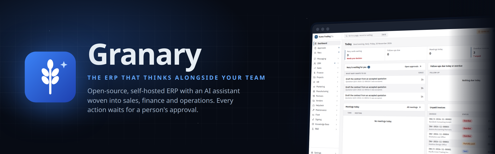
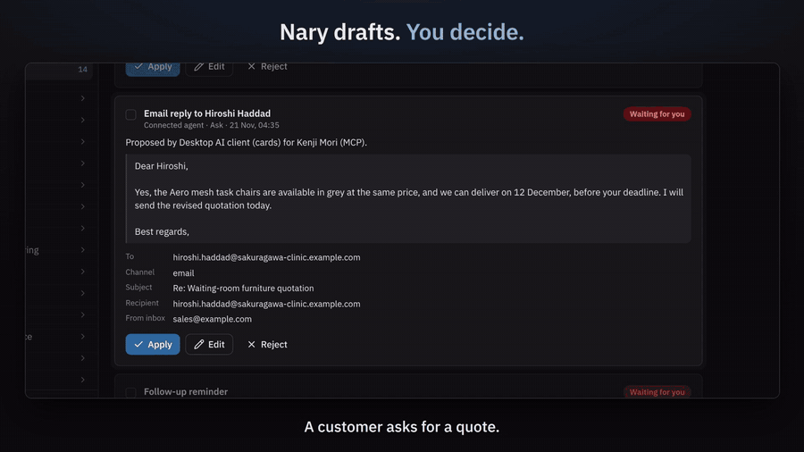
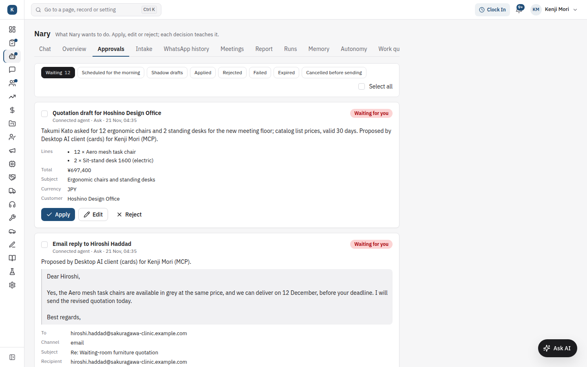

<p align="center">
  
</p>

<p align="center">
  <a href="https://github.com/halogass/Granary-ERP/actions/workflows/ci.yml"></a>
  <a href="#licence"></a>
  
  
  
  
</p>

<p align="center">
  <a href="https://granary-demo.pages.dev"><b>Live demo</b></a> ·
  <a href="https://github.com/halogass/Granary-ERP/wiki"><b>Wiki</b></a> ·
  <a href="https://github.com/halogass/Granary-ERP/wiki/Installation">Install</a> ·
  <a href="https://github.com/halogass/Granary-ERP/wiki/First-Steps">First steps</a> ·
  <a href="https://github.com/halogass/Granary-ERP/wiki/AI-Across-Granary">AI across Granary</a> ·
  <a href="https://github.com/halogass/Granary-ERP/discussions">Discussions</a> ·
  <a href="CONTRIBUTING.md">Contributing</a> ·
  <a href="SECURITY.md">Security</a>
</p>

<p align="center">
  <a href="https://github.com/halogass/Granary-ERP/releases/download/v1.0.1/granary-launch.mp4">
    
  </a>
  <br><sub>▶ <a href="https://github.com/halogass/Granary-ERP/releases/download/v1.0.1/granary-launch.mp4">Watch the 1-minute launch video</a></sub>
</p>

> **Try it in your browser:** [granary-demo.pages.dev](https://granary-demo.pages.dev) is an interactive demo with
> sample data. Click through every module and apply Nary's cards. Nothing is saved, and the AI chat gives a scripted
> answer there; install Granary to use your own AI model.

Granary is a free, self-hosted ERP for small and mid-sized companies, with an AI assistant, **Nary**, built into its
business processes rather than bolted on. Nary scores and researches your leads, drafts replies, quotations and
proposals, reads the attachments customers send, follows up on quotations, prepares invoices and project kickoffs,
and answers questions from your own SOPs and records. **Every action that commits the company (a message to a
customer, a price, an invoice, a merge) comes to a person as a card to approve first.**

One web application covers CRM and sales, finance, HR and payroll, projects, manufacturing and inventory,
procurement, partners, marketing, messaging and video calls. The backend is Rust, the frontend Next.js, and the
whole stack runs with Docker Compose on one server. Bring your own AI provider (Anthropic, OpenAI or any
OpenAI-compatible API, Gemini, DeepSeek, or a local model through Ollama), or connect your own AI client over MCP.

<p align="center">
  
  <br><sub>Nary's work arrives as cards: here a quotation drafted from a customer conversation and an email reply, waiting for a person to apply them.</sub>
</p>

---

## AI across the ERP

| Where | What Nary does |
|---|---|
| CRM | Scores leads (hot, warm, cold, with reasons and a next step), writes an AI brief of any record, enriches new organizations, researches companies and people on the web, finds duplicates, keeps deal notes (fit, negotiation hints, follow-up cadence) |
| Inboxes | Triages incoming email and WhatsApp, takes in new leads from web forms, drafts replies, reads PDFs and images, transcribes voice notes on your own server |
| Sales | Drafts quotations from a conversation (priced by your price lists and rules), drafts proposals with figures and a cost sheet, follows up on sent quotations, drafts the contract and the down-payment proforma when a customer accepts |
| Finance and projects | Lists overdue invoices, summarizes revenue, drafts proformas and invoices, hands a won deal to delivery with a kickoff plan |
| Knowledge | Answers from your published SOPs with citations, turns a PDF into an article, drafts SOP revisions, keeps an AI-only knowledge library |
| Your own AI client | The same tools over MCP, signed in as a person and limited to that person's permissions |

Nary's tools run with the signed-in person's permissions. Proposed changes arrive as cards you **Apply**, edit or
dismiss, and you decide which kinds of action may later run on their own. The full map, including which actions
save directly, is in [AI Across Granary](https://github.com/halogass/Granary-ERP/wiki/AI-Across-Granary).

---

## Modules

| Area | What it covers |
|---|---|
| CRM | Leads, contacts, organizations, deals and pipeline, activities, custom attributes, filtered search, duplicate detection and merge, follow-up reminders, AI enrichment and web research |
| CRM inboxes | Shared email inboxes (IMAP/SMTP, Sent folder and read status mirrored with the mail server), scheduled sends, a WhatsApp inbox (needs a WhatsApp bridge you provide, see below) |
| Sales | Quotations with revisions, optional lines, notes templates and pricing rules; proposals; contracts; product catalog with price lists; quotation to invoice |
| Approvals and documents | Approval policies per document type, approval stamped on the PDF, a verification QR on every page (`/v/<token>`), PAdES-sealed e-signature for contracts and offer letters, sending documents by email |
| Finance | Invoices and proformas with per-line discount and tax, credit notes, refunds, payments, bank accounts and reconciliation, chart of accounts, journal, automatic GL posting, fiscal periods, reports, expenses, schedules, taxes and withholding tax, fixed assets, budgets |
| Multi-currency | USD, EUR, GBP, JPY, SGD, AUD and CNY; FX rates from ExchangeRate-API or entered by hand; FX gain and loss in the ledger; a missing rate is refused, never treated as 1.0 |
| HR | Employees, attendance, leave, payroll with configurable contributions and progressive income tax, overtime, recruiting and hiring, offer letters, org chart |
| Face clock-in | Self-hosted face matching with liveness checks, GPS geofence, registered kiosk tablets |
| Projects | Projects, tasks, time logs, comments and activity feed |
| Manufacturing and inventory | Products, bills of materials, production orders, QC, warehouses, transfers, unit serials, warranty |
| Operations | Fleet, maintenance, helpdesk |
| Procurement | Vendors, contractor requests, RFQs, purchase orders, goods receipts, three-way match, work orders, vendor invoices with withholding tax, vendor portal |
| Partners | Partner accounts, deal registration, leads, commissions, MDF, resources and training, partner portal |
| Marketing | Campaigns, content calendar, email campaigns with a signature footer, one-click unsubscribe and preview |
| Knowledge | Markdown articles and SOPs with draft revisions and approval, a document library with versions and download watermarks, PDF import |
| R&D | Product lines, projects, backlog, two-way GitLab issue sync |
| Collaboration | Channels, threads, reactions, mentions and file uploads (WebSocket + Redis), a personal email client (per-user IMAP/SMTP), WebRTC video calls with TURN, guest join and recording |
| Administration | Users, roles and permissions, portal users, two-factor sign-in, settings for every business rule |

Business numbers (tax rates, payroll contributions and wage caps, income tax brackets, approval limits, reminder
schedules, currency decimals) are settings edited in the UI, not code. A missing value makes the action fail
with an error that names the setting.

---

## Stack

| Layer | Technology |
|---|---|
| Frontend | Next.js 14 (App Router, TypeScript), Tailwind CSS, NextAuth v4, PWA |
| Backend | Rust (axum, sqlx, tokio) in `rust-version/`: `granary-api` (HTTP API), `granary-worker` (background jobs and their schedule), `granary-migrate` and `granary-seed` |
| Sidecars | Rust services for PDF rendering (Chromium), face matching (ONNX Runtime), WebRTC signalling and web research; a Python speech-to-text service (faster-whisper) in `services/stt` |
| Data | PostgreSQL 16 with pgvector, Redis 7, SeaweedFS (S3-compatible object storage) |
| Other | SearXNG (self-hosted search), coturn (TURN/STUN), Nginx on the host as the reverse proxy |

More in [Architecture](docs/ARCHITECTURE.md).

---

## Quick start

You need Docker with the Compose plugin. Building the Rust images needs about 8 GB of RAM and 10 GB of disk.

```bash
git clone <your-repo-url> granary
cd granary
cp .env.example .env
```

Edit `.env` and replace every value marked `← CHANGE THIS`. Make each secret its own random value
(`openssl rand -hex 32`). Compose refuses to start without `REDIS_PASSWORD`, `NEXTAUTH_SECRET` and
`SIGNAL_TICKET_KEY`; `REDIS_URL` and `CELERY_BROKER_URL` must carry the Redis password, and `DATABASE_URL` must
carry `POSTGRES_PASSWORD`. To try Granary on your own machine without Nginx, also set:

```dotenv
APP_URL=http://localhost:3000
SIGNAL_URL=ws://localhost:3003
CORS_ORIGINS=["http://localhost:3000"]
MINIO_PUBLIC_URL=http://localhost:9000
```

Then start it. Compose downloads the prebuilt images of the release in `GRANARY_VERSION`
(`ghcr.io/halogass/granary-*`, x86-64); `docker compose build` compiles them from source instead:

```bash
docker compose up -d
docker compose logs -f backend      # wait for "listening"
```

On every start the backend runs `granary-migrate` (pending migrations), then `granary-seed` (default data that is
missing; it never overwrites your edits), then `granary-api`. Open `http://localhost:3000`. In production, Nginx
on the host proxies the frontend and the API (see [Deployment](docs/DEPLOYMENT.md)).

| Service | Purpose | Host port |
|---|---|---|
| `frontend` | Next.js | 127.0.0.1:3000 |
| `backend` | `granary-api` | 127.0.0.1:8000 |
| `worker`, `beat` | Background jobs and their schedule (same image as `backend`) | none |
| `db`, `redis` | PostgreSQL + pgvector, Redis | none |
| `storage` | Object storage (SeaweedFS, S3 API) | 127.0.0.1:9000 |
| `pdf`, `face`, `research`, `searxng`, `stt` | Sidecars | none |
| `signal` | WebRTC signalling | 127.0.0.1:3003 |
| `coturn` | TURN/STUN for video calls | host network |

### First sign-in

The seed creates one superadmin on the first start, from these `.env` values:

```dotenv
SUPERADMIN_EMAIL=owner@example.com
SUPERADMIN_NAME=Robert Smith
SUPERADMIN_PASSWORD=change-this-strong-password-immediately
```

Sign in with that email and password, then change the password. The superadmin is created only while none
exists, so changing these values later has no effect.

### Before going live

- **Company profile.** Settings → Company & branding: legal name, address, tax ID, registration number,
  signatory, logo and letterhead. They appear on every document you send. Set the time zone and date format
  under Regional in the same area.
- **Functional currency.** Settings → Money & tax → Currencies. It defaults to USD and can't be changed once
  journal entries are posted.
- **Approval limits.** Settings → Approvals & signing → Approval policies. The amount limits in the shipped
  policies are in the functional currency and are sized for a currency like JPY (a purchase order above
  5,000,000 goes to the Owner, for example). Adjust every limit for your base currency before anyone submits a
  document.
- **Tax and payroll.** Add the taxes you charge and withhold in Finance → Taxes (none are seeded). Set payroll
  contributions, income tax and overtime in Settings → People & payroll. Payroll refuses to run while they are
  empty or malformed.
- **CRM inboxes.** Settings → Email & WhatsApp: the system email account and at least one CRM inbox (SMTP and
  IMAP). Quotations, invoices and campaigns are sent through them.
- **Secrets in Settings.** AI provider keys (Settings → Nary & AI → Providers & keys), mail passwords, the
  ExchangeRate-API key and the GitLab token are stored encrypted in the database, not in `.env`. When the API
  and the worker start, they log every secret (in `.env` or in Settings) that still holds a placeholder value
  and notify the Owner; `JWT_SECRET_KEY`, `APP_SECRET_KEY` and `NEXTAUTH_SECRET` must not hold a placeholder at all
  (the API refuses to start).

[Configuration](docs/CONFIGURATION.md) walks through every setting.

---

## AI providers, MCP and WhatsApp

**Providers.** Anthropic, OpenAI and OpenAI-compatible endpoints, Gemini, DeepSeek and Ollama, chosen per job in
Settings → Nary & AI, with a cheap model first, a monthly budget cap and keys stored encrypted in the database.

**MCP.** The same tools are available to your AI client at `/api/v1/mcp` (JSON-RPC over HTTP). A connection signs
in with a personal access token (Settings → Integrations & access → MCP access) or a browser login, acts as that
person with their permissions, and is narrowed further by its level: read, propose or act.

**WhatsApp.** Granary does not ship a WhatsApp Web bridge. The WhatsApp inbox and Nary's WhatsApp channel talk
to an HTTP service at `WHATSAPP_SERVICE_URL`; without one they stay disconnected and the rest of Granary works.

---

## Documentation

| Guide | Contents |
|---|---|
| [Wiki](https://github.com/halogass/Granary-ERP/wiki) | Installation, first steps, a guide to every module, AI across Granary, administration, developer guide |
| [Architecture](docs/ARCHITECTURE.md) | Services, request routing, auth, AI, documents, money and ledger, background jobs, source layout |
| [Deployment](docs/DEPLOYMENT.md) | Server setup, environment, Nginx (LAN, Cloudflare Tunnel, Let's Encrypt), upgrades |
| [Configuration](docs/CONFIGURATION.md) | Every setting after the first sign-in, and the environment variables |
| [Maintenance](docs/MAINTENANCE.md) | Backups, updates, background jobs, logs, database checks |
| [Troubleshooting](docs/TROUBLESHOOTING.md) | Common problems and fixes |
| [Contributing](CONTRIBUTING.md) | Development setup, tests, checks |
| [Security](SECURITY.md) | Reporting a vulnerability |

---

## Licence

Granary is dual-licensed under the [MIT License](LICENSE-MIT) or the [Apache License, Version 2.0](LICENSE-APACHE),
at your option. Contributions are accepted under the same terms. Third-party components keep their own
licences; see [NOTICE](NOTICE).
